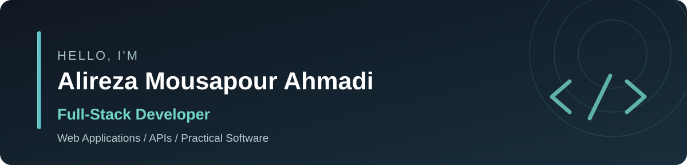

  

  
<strong>Building thoughtful interfaces, practical APIs, and useful software.</strong>

  
  
  

## About Me

I'm a **full-stack developer** based in **Babolsar, Mazandaran, Iran**, with a bachelor's degree from **Babol Noshirvani University of Technology**.

I enjoy building software across the stack—from responsive user interfaces to backend APIs and databases. My main focus is **web development**, and I'm also interested in **software engineering and AI**. I've additionally worked on mobile applications and Telegram bots.

## Tech Stack

**Frontend**

**Backend & Languages**

**Database & Tools**

`SQLAlchemy` · `Alembic` · `Pydantic` · `React Native`

## Featured Projects

<table>
<tr>
<td width="50%" valign="top">

### 🔗 Shortify
**URL Shortener & Analytics**

A URL-shortening project with a Persian RTL dashboard, link-management screens, analytics UI, and a separate FastAPI backend for authentication, links, and click analytics.

**Stack:** React · TypeScript · Tailwind CSS · FastAPI · PostgreSQL

[**Frontend ↗**](https://github.com/AlirezaMP2003/Shortify-Frontend) &nbsp;|&nbsp; [**Backend ↗**](https://github.com/AlirezaMP2003/Shortify-Backend)

Portfolio project · Some frontend interactions currently use mock data; full integration is not claimed.

</td>
<td width="50%" valign="top">

### 🧩 PersianMock
**Persian Synthetic Data Generator**

A customizable Iranian sample-data generator with a schema builder, record preview, and JSON, CSV, SQL, and Excel export options.

**Stack:** Vue 3 · Tailwind CSS · FastAPI · PostgreSQL · Pydantic

[**Frontend ↗**](https://github.com/AlirezaMP2003/PersianMock-Frontend) &nbsp;|&nbsp; [**Backend ↗**](https://github.com/AlirezaMP2003/PersianMock_Backend)

Portfolio MVP · Not presented as a production service.

</td>
</tr>
</table>

## More Projects

| Project | Description | Tech |
|:---|:---|:---|
| [**Othello Game ↗**](https://github.com/AlirezaMP2003/Othello-game) | Browser-based two-player Reversi game | HTML, CSS, JavaScript |
| [**Restaurant Management ↗**](https://github.com/AlirezaMP2003/Restaurant) | Console-based restaurant ordering and management system | C++ |

## Let's Connect

I'm interested in building useful software and growing as a full-stack developer. Feel free to reach out or explore my repositories.

